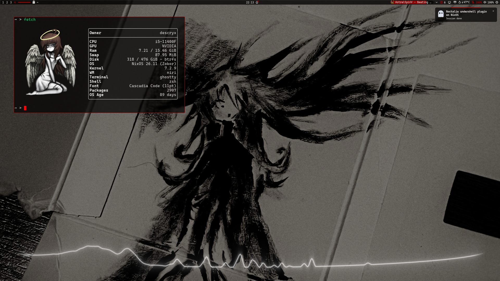
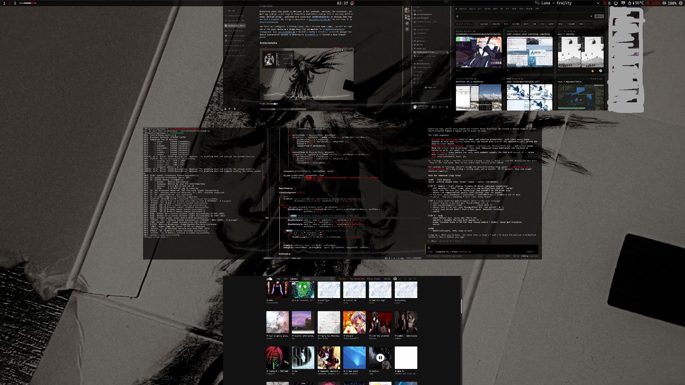
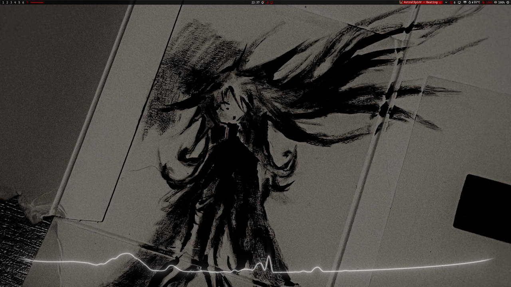

# nix-config

My personal, flake-based [NixOS](https://nixos.org) + [home-manager](https://github.com/nix-community/home-manager)
config for two machines. Inputs are pinned in `flake.lock`; dotfiles are
symlinked out of the store so they stay editable.

  
More screenshots

   
  

    
    
    
  

| Device | Hostname | Hardware | Config |
|--------|----------|----------|--------|
| Desktop | `desk` | NVIDIA + Intel | [`hosts/desk/`](hosts/desk/) |
| Laptop  | `t480` | ThinkPad T480 (Intel) | [`hosts/t480/`](hosts/t480/) |

## How to use

Prerequisites: NixOS unstable with flakes enabled, plus
[direnv](https://direnv.net) and nix-direnv.

**Dotfiles only.** Every feature keeps its config in
`modules/<category>/<feature>/config/`; browse `modules/*/*/config/` and copy what
you need. Most of it assumes [Niri](https://github.com/YaLTeR/niri) with
[Noctalia](https://github.com/noctalia-dev/noctalia), and several files hardcode
`/home/descryx` paths.

**One piece.** `modules/` is grouped by category, one folder per feature, holding
any of `system.nix`, `home.nix` and `config/`. Copy the folder and import the
file(s) you need.

**Whole config.** Set your values in [`local.nix`](local.nix), adjust
`hardware-configuration.nix`, then rebuild with `nh os switch`. For a new machine,
start from [`hosts/_template/`](hosts/_template/) - an untested draft.

**Just looking.** How it all fits together is in
[docs/ARCHITECTURE.md](docs/ARCHITECTURE.md), commands in
[docs/COMMANDS.md](docs/COMMANDS.md), credits in [docs/CREDITS.md](docs/CREDITS.md).

## AI assistance & scope

Parts of this were written with an AI assistant ([opencode](https://opencode.ai)),
mostly for learning and tedious refactoring. It is a personal project tuned to
specific hardware and shared as is: no warranty, and you will need to adapt it.

## License

MIT, see [`LICENSE`](LICENSE). This covers the Nix configuration only; bundled
third-party configs and assets keep their own licenses (see
[docs/CREDITS.md](docs/CREDITS.md)).
